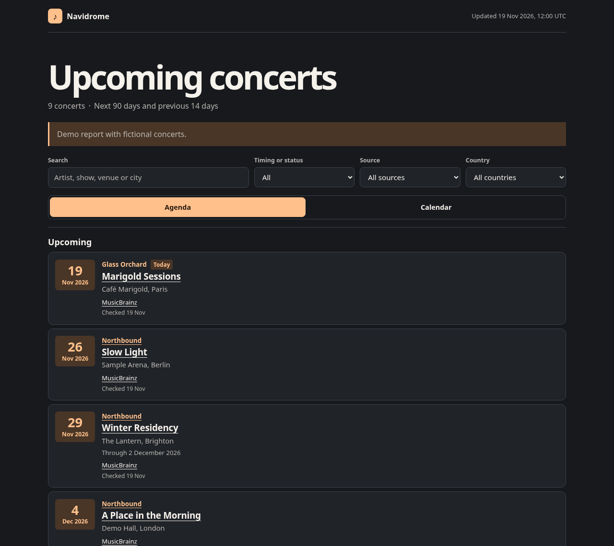
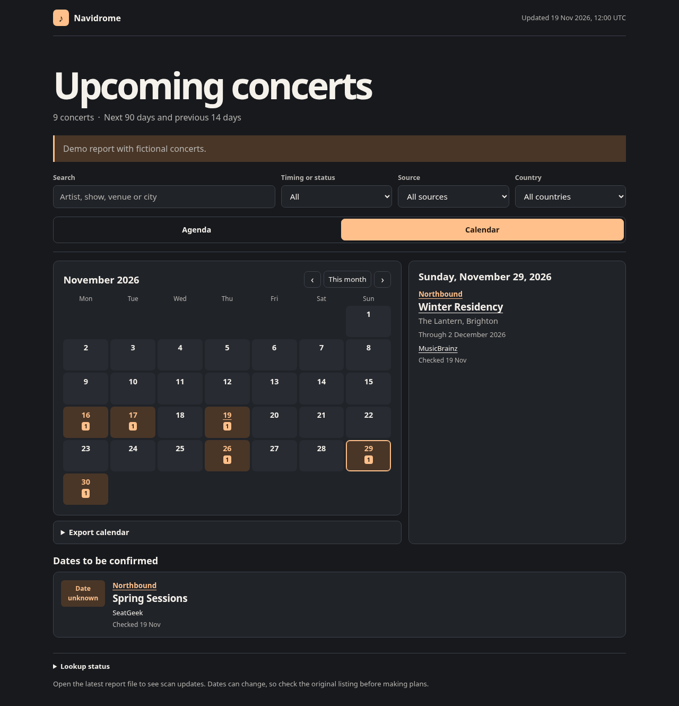

# navidrome-upcoming-concerts-plugin

**Your music library. Your next live show.**

[](https://github.com/JLS1996/navidrome-upcoming-concerts-plugin/actions/workflows/ci.yml)
[](LICENSE)
[](https://github.com/JLS1996/navidrome-upcoming-concerts-plugin/releases/latest)
[](https://github.com/navidrome/navidrome/releases/tag/v0.64.2)

Discover **upcoming concerts by artists already in your [Navidrome](https://www.navidrome.org/) library**. Browse a private offline dashboard, explore a month calendar, and export your shows to a calendar app. MusicBrainz supplies supplementary events; optional SeatGeek, Skiddle and Ticketmaster adapters expand coverage.

**[Download the plugin](https://github.com/JLS1996/navidrome-upcoming-concerts-plugin/releases/latest/download/navidrome-upcoming-concerts-plugin.ndp)** · [Setup guide](docs/installation.md) · [Provider configuration](docs/concert-providers.md) · [Release notes](docs/releases/v0.6.0.md)

> [!IMPORTANT]
> **AI-assisted development**
>
> This plugin was developed with OpenAI Codex under human direction. Its implementation and tests are AI-assisted; human review is welcome.



*Fictional demo concerts. The merged entry retains each provider's attribution and event link.*

## Features

- **Artists from your library:** use only libraries accessible to the granted Navidrome user, with optional filtering for standalone artist credits.
- **Multiple concert sources:** enable SeatGeek, Skiddle and Ticketmaster independently. No paid API subscription or LLM service is required by the plugin.
- **Useful concert details:** open the show title for the preferred listing or pick a provider below the show time. Artist names link to official websites when MusicBrainz supplies one.
- **Conservative deduplication:** merge clear cross-source matches while retaining all source links. Different show times and ambiguous matches stay separate; a setting lets you show sources separately.
- **An offline concert agenda:** search by artist, show, venue or city, filter by timing, listing status, source or country, and browse a keyboard-accessible month calendar. Bright, dark and black themes are available.
- **Calendars and optional alerts:** download `.ics`, or opt into ntfy, CalDAV or Google Calendar integrations.
- **Resumable lookups:** persist artist mappings, pagination, request budgets and cached results. Failed refreshes retain the last completed snapshot.

**Your music files, ratings and library metadata are not changed.** Reports stay in plugin storage. The plugin adds no public web server or artist-page panel; external calendar/notification writes happen only when configured.

<details>
<summary>See the month calendar</summary>



*Select a day for its concerts. Partial or unknown dates are kept outside the day grid and excluded from ICS export.*

</details>

## Installation

Built and tested with **Navidrome 0.64.2** and native plugins enabled. Installing the package needs no Go, TinyGo, Python or additional web server on your Navidrome host.

1. Download **[navidrome-upcoming-concerts-plugin.ndp](https://github.com/JLS1996/navidrome-upcoming-concerts-plugin/releases/latest/download/navidrome-upcoming-concerts-plugin.ndp)**. [SHA-256 checksums](https://github.com/JLS1996/navidrome-upcoming-concerts-plugin/releases/latest/download/SHA256SUMS) are included with every release.
2. Copy it into your Navidrome plugins directory and rescan plugins, or restart Navidrome.
3. Open the plugin settings, grant **exactly one user** and the intended libraries, and enable it. Library write access is not needed.
4. In **Concert providers**, enable the sources you want and enter your own credentials. SeatGeek and Skiddle work with Ticketmaster disabled.
5. Open the generated **`upcoming-concerts.html`** in a browser. Download **`music-concerts.ics`** from the dashboard or copy it from storage.

Files are created under:

```text
<DataFolder>/plugins/navidrome-upcoming-concerts-plugin/storage/
```

For Docker or a different OS account, copy the files from the host/container or arrange private host-side file access. Opening the dashboard does not require a running companion service. [Installation and file access →](docs/installation.md)

**Upgrading?** Replace the package and **keep plugin storage**. The next plugin run rebuilds the dashboard. Official artist websites appear as MusicBrainz checks finish. [Installation and upgrades →](docs/installation.md)

## Concert providers

| Source | Credentials | Role |
|---|---|---|
| MusicBrainz | No personal API key | Supplementary community event data; enabled automatically |
| SeatGeek | Your client ID; optional client secret | Optional performer-based concert searches |
| Skiddle | Your API key | Optional artist-tagged events; personal, non-commercial use |
| Ticketmaster Discovery | Your developer API key | Optional attraction-based event searches |

Keys are masked in Navidrome settings and are not embedded in reports or exported calendars. Each optional provider has its own persistent local request budget. Defaults are **1,000/day for SeatGeek, 500/day for Skiddle and 4,000/day for Ticketmaster**; these are plugin caps, not promises about your provider account's allowance. Configure them within your account limits.

**Coverage is incomplete.** “No concerts found,” “lookup failed,” and “artist identity unresolved” are different outcomes. A complete search with one exact-name candidate can resolve automatically, but names are not proof of identity. Manual provider IDs take precedence; ambiguous or truncated results remain unresolved. You can disable name-based automatic matching.

[Credentials, artist mappings, refresh behavior and limits →](docs/concert-providers.md)

## Running and configuring

| Setting | Default |
|---|---|
| Report window | Today through the next **90 days** |
| Theme | Dark |
| Cross-source deduplication | On |
| Single exact-name provider matching | On |
| Optional API providers | Off until configured |
| Notifications and calendar sync | Off |

Flip the **manual refresh** switch in either direction and save to request another refresh. Budgets and provider cooldowns still apply. The dashboard shows per-provider completion, queued/retrying work and unresolved identities. Refresh or copy a new HTML file to see updated results; an already opened file is a snapshot.

ICS exports use all-day events, retain source links and include supplied local times in descriptions. Ongoing date ranges and cancellation status are retained. Real calendar accounts, device sharing and deployment permissions may need additional checks. [Calendars and alerts →](docs/integrations.md)

## Documentation and help

| Guide | Covers |
|---|---|
| [Installation](docs/installation.md) | Plugin setup, storage, Docker and upgrades |
| [Configuration](docs/configuration.md) | Matching, exclusions, themes and refreshes |
| [Concert providers](docs/concert-providers.md) | API keys, mappings, budgets, attribution and source limits |
| [Calendars and notifications](docs/integrations.md) | ICS, ntfy, CalDAV and Google Calendar |
| [Known limitations](docs/limitations.md) | Coverage, uncertain dates and deduplication boundaries |
| [Privacy and security](SECURITY.md) | Library permissions, credentials and local reports |
| [Development](docs/development.md) · [Validation](TESTING.md) | Reproducible builds and test coverage |

Validation includes native race tests, actual Navidrome/WASM integration, configuration save/reload checks and mobile/desktop Chromium tests. Service fixtures are fictional; these tests do not certify complete live-provider coverage.

[Report a bug or suggest a feature](https://github.com/JLS1996/navidrome-upcoming-concerts-plugin/issues). Include plugin/Navidrome versions, the provider, relevant settings and a reproducible description. **Remove keys, tokens, usernames and personal library exports from public reports.**

## Credits and license

Derived from [navidrome-upcoming-releases-plugin](https://github.com/JLS1996/navidrome-upcoming-releases-plugin), carrying forward its scoped library integration and calendar and notification foundations.

Released under the [MIT License](LICENSE). Dependency and brand notices are in [THIRD_PARTY_NOTICES.md](THIRD_PARTY_NOTICES.md). Concert data and provider trademarks remain subject to their respective terms.
